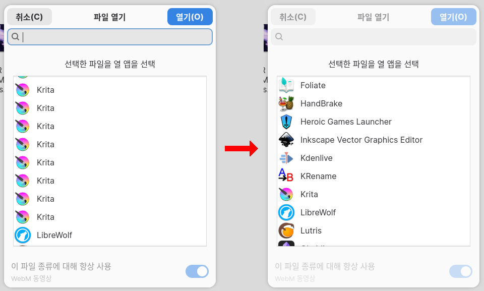

# Miscellaneous Tips for Linux Desktop

## Organizing the "Open Files" list in Krita software
- Krita has a problem where too many execution options appear in GNOME's "Open File" because individual associations exist for each extension. Therefore, you must hide everything except the launcher.
- [org.kde.krita-desktop.tar.gz](https://raw.githubusercontent.com/kappa-k0801/linux-desktop-miscellaneous-tips/main/org.kde.krita-desktop.tar.gz) -> Download This file and copy it to ~/.local/share/applications/
- Result


## Safe sudo
- If it is not a system command, a virus scan is performed first before executing the command.
- safesudo
```
#!/bin/sh

[[ z$1 == "z" ]] && sudo --help && exit 0

if [[ $(whereis $1 | awk '{print $2}' | grep '/usr/bin' | wc -l) != "1" ]]
then
        clamscan $1
        [[ $? == "1" ]] && exit 1
fi

echo ""
echo "---------------------------------------"
echo ""

/usr/bin/sudo $@
```
- sample
```
$ safesudo ./eicar.txt 
Loading:     5s, ETA:   0s [========================>]    3.63M/3.63M sigs       
Compiling:   2s, ETA:   0s [========================>]       41/41 tasks 

./eicar.txt: Eicar-Signature FOUND

----------- SCAN SUMMARY -----------
Known viruses: 3627983
Engine version: 1.4.5
Scanned directories: 0
Scanned files: 1
Infected files: 1
Data scanned: 0.00 MB
Data read: 0.00 MB (ratio 0.00:1)
Time: 7.248 sec (0 m 7 s)
Start Date: 2026:08:01 07:52:36
End Date:   2026:08:01 07:52:43
```
